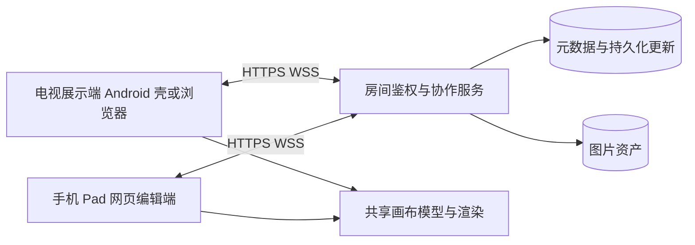

# 系统架构与技术决策

本方案优先让多端共享同一套文档模型和渲染逻辑，电视与手机只在输入方式和镜头策略上不同。技术栈为候选基线，M1 实测后冻结依赖版本。

## 结构

## 候选技术

| 层 | 初选 | 选择依据与代价 |
| --- | --- | --- |
| Web 应用 | TypeScript、React、Vite | 共享 UI 与工程工具；高频指针和笔迹避免驱动整棵 React 树重渲染 |
| 画布 | Konva + 自有对象模型 | 便于定制电视视角与脑图；需要自己实现编辑器交互，M1 必须验证成本 |
| 协同文档 | Yjs | 适合合并共享状态；权限、语义冲突和落盘确认仍需服务端设计 |
| 实时连接 | WebSocket + Awareness | 内容增量、在场信息和草稿预览分流 |
| 服务 | Node.js LTS、TypeScript | 统一协议类型；M1 锁定当时可用版本，不使用浮动 latest |
| 存储 | PostgreSQL + 文件卷或 S3 兼容对象存储 | 白板元数据、增量与快照持久化；图片不塞入协同文档 |
| TV 外壳 | Kotlin Android TV + 受控 WebView 候选 | 先证明目标设备运行能力，再制作安装包；不默认兼容所有安卓电视 |
| 测试 | 单元测试、WebSocket 集成、Playwright、多设备人工测试 | 浏览器自动化不能替代电视与触控笔真机测试 |

单实例服务优先，不提前引入 Redis。横向扩容前需要房间路由、广播和持久化一致性方案。

## 画布方案比较

Konva 是交互式 Canvas 框架，提供对象和事件能力，不是开箱即用协作白板；选择它意味着承担编辑器开发。参见 [官方文档](https://konvajs.org/docs/)。

Excalidraw 可复用成熟绘图界面，仓库采用 MIT 许可；本项目仍需评估组件 API 与脑图、电视展示的结合成本，不能把在线示例的协作能力等同于嵌入组件已经提供完整后端。参见 [官方仓库](https://github.com/excalidraw/excalidraw)。

tldraw 是候选完整编辑器 SDK，但生产使用需要相应有效许可；在授权方案明确前不把它列为默认生产依赖。参见 [官方许可说明](https://tldraw.dev/community/license)。

M1 用同样的“电视总览＋独立编辑视角＋笔迹过程＋节点连接”样例评估 Konva。若编辑复杂度或真机性能不满足目标，记录 ADR 后切换方案，不能在核心模型锁定后无评估地叠加第二套编辑器。

## 独立镜头

文档只保存世界坐标。每个客户端维护自己的 camera {x, y, zoom}；视口大小属于本地状态。电视镜头由总览算法或主持人控制，普通成员拖动画布不广播为电视控制。

总览对文档与活动草稿求包围盒，根据扣除安全区和覆盖层后的可用尺寸计算缩放。不把空闲指针、选择框或聊天标签纳入内容尺寸。内容过大时仍完整显示，并提供聚焦入口。

## 持久化与恢复

服务端每房间维护 Y.Doc，验证权限后接收更新；先持久化更新并返回保存确认，再将其视为“已保存”。可先广播以降低延迟，但客户端必须区分已同步与已落盘。

定期生成带 schemaVersion 的快照，保留快照后的更新。启动时重建文档，快照压缩需原子切换并保留回滚点。图片独立备份；只备份数据库不构成完整恢复。

短断线允许继续本地编辑并明确显示“待同步”，恢复时先重新鉴权。权限已撤销时不回灌本地更改，提供本地副本导出；完整离线协作与跨设备离线冲突管理暂缓。

## 权限与服务端约束

展示、编辑、主持人凭证分离；服务端验证房间、成员、角色和有效期，电视只读凭证不能发送内容更新。邀请短期有效并可轮换，关闭房间需立即关闭旧写入会话。

Yjs 更新是二进制数据，不能仅靠 WebSocket 已登录就信任内容。限制消息大小/频率、文档容量和坐标范围；必要时在隔离副本应用增量后验证类型与结构再合入权威文档。脑图结构等语义操作走明确的服务端命令。

HTTPS/WSS 为默认；日志不记录完整邀请凭证或文档正文。图片验证实际格式、尺寸、解码像素数，首版只允许 JPEG/PNG/WebP，拒绝可执行 SVG；移除位置等敏感元数据。跨房间访问与资产鉴权必须有集成测试。

## 部署路径

开发与早期验证：单服务实例、PostgreSQL、持久化资产卷；提供容器编排后可评估部署到 NAS 或独立服务器。公网或内网部署尚未选定，不自动开放端口。

手机通过二维码访问可到达的 HTTPS 域名；不能使用 localhost 或假设电视 IP 可从手机访问。内网隔离、访客 Wi-Fi 和移动网络需要分别验证。公网部署地点、备份保留时间、域名和访问范围在试用部署前确定。

Android TV 需独立验证启动入口、遥控器导航和设备兼容，参见 [Android TV 创建指南](https://developer.android.com/training/tv/get-started/create) 与 [TV 质量要求](https://developer.android.com/docs/quality-guidelines/tv-app-quality)。首个 Web 演示不代表已交付电视 APP。
